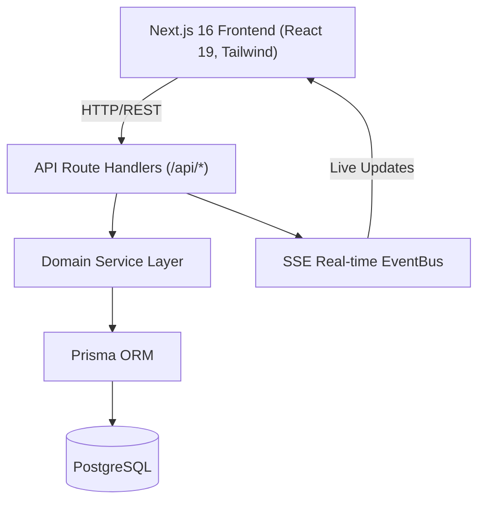

# TaskFlow 🚀

> A lean, production-quality, full-stack collaborative project management platform (Linear / Trello hybrid).

[](https://github.com/Chandana848/taskflow/actions)
[](https://opensource.org/licenses/MIT)
[](https://github.com/Chandana848/taskflow)

---

## ✨ Features

- **Interactive Kanban Boards**: Native drag-and-drop card ordering and stage transitions.
- **Multiple Views**: Kanban, List view, Calendar view, and Timeline Gantt schedule.
- **Enterprise Auth & RBAC**: Email/password, GitHub OAuth, JWT HttpOnly sessions, and 4-tier roles (Owner, Admin, Member, Viewer).
- **Real-Time Collaboration**: Instant synchronization via Server-Sent Events (SSE).
- **Sprint Analytics**: Velocity tracking, burndown charts, lead/cycle time metrics, and CFD diagrams.
- **Universal Search**: Fast multi-entity search with filter chips and saved views.
- **Extensible Webhooks**: Outbound HMAC-SHA256 signatures with Slack and Discord formatters.
- **Data Portability**: Full CSV and JSON export/import pipelines.
- **Dark / Light Theme**: Native design system tokens with seamless theme switching.

---

## 🏗️ Architecture



---

## 🚀 Quick Start

```bash
# 1. Clone repository
git clone https://github.com/Chandana848/taskflow.git
cd taskflow

# 2. Install dependencies
npm install

# 3. Setup environment and database
cp .env.example .env
npx prisma db push
npx prisma db seed

# 4. Start development server
npm run dev
```

App runs at `http://localhost:3000`.

### Running with Docker

```bash
docker compose up -d
```

---

## 🧪 Testing

```bash
npm test            # Run all 51 Jest test suites
npm run typecheck   # TypeScript strict type checking
npm run lint        # ESLint 9 validation
npm run build       # Production webpack build
```

---

## 📄 License

MIT © [TaskFlow Team](https://github.com/Chandana848/taskflow)
